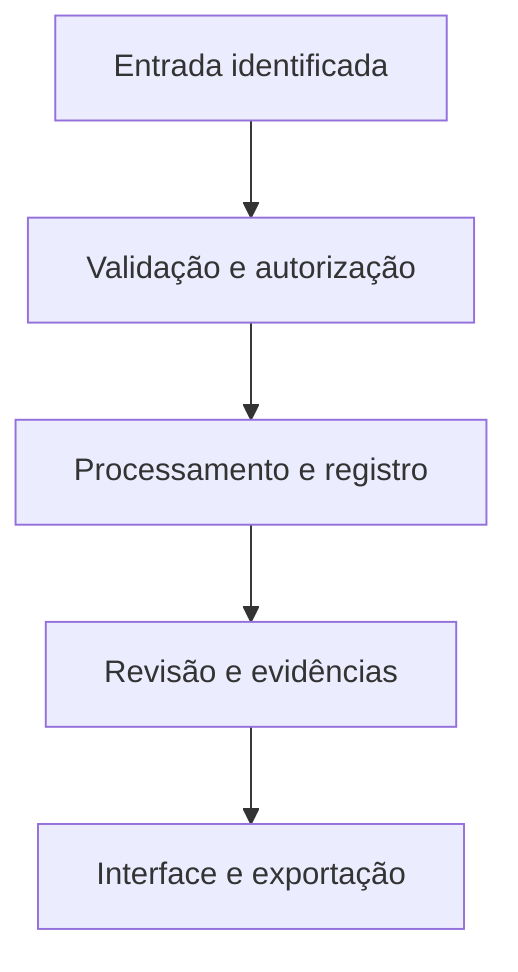

# Arquitetura proposta

## Receber

Cenas orbitais, fotos e esforço de campo.

## Preparar

Qualidade, georreferência e duplicatas.

## Identificar

Avaliações independentes e abstenção.

## Confrontar

Revisão, habitat e ocupação.

## Priorizar

Mapa agregado de áreas a verificar.

## Dados do domínio

- **Campaign / Station / Visit** — Protocolo, local, data, equipe e esforço de amostragem.
- **Observation / Media / EventGroup** — Registro, fotografia, autoria, precisão e agrupamento de duplicatas.
- **Taxon / Identification / Abstention** — Hipótese independente, justificativa, autor e versão.
- **Review / ReferenceLabel** — Parecer especializado e conjunto de validação isolado.
- **RasterAsset / HabitatCell** — Sensor, máscara, período, CRS e área de habitat.
- **ThreatAssessment / PriorityRun** — Fonte oficial, data, escala; modelo e pesos da triagem separados.

## Contas e permissões

Sessão no servidor, autorização por papel e propriedade, arquivos privados por escopo e auditoria de mudanças. A interface nunca é a única barreira de acesso.
